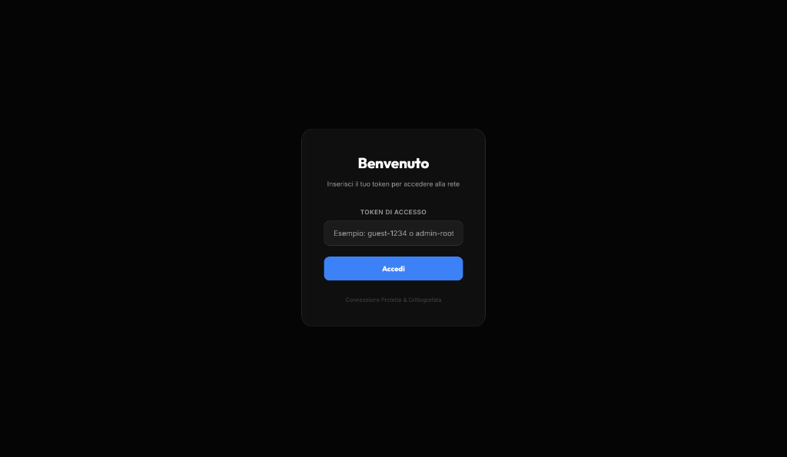
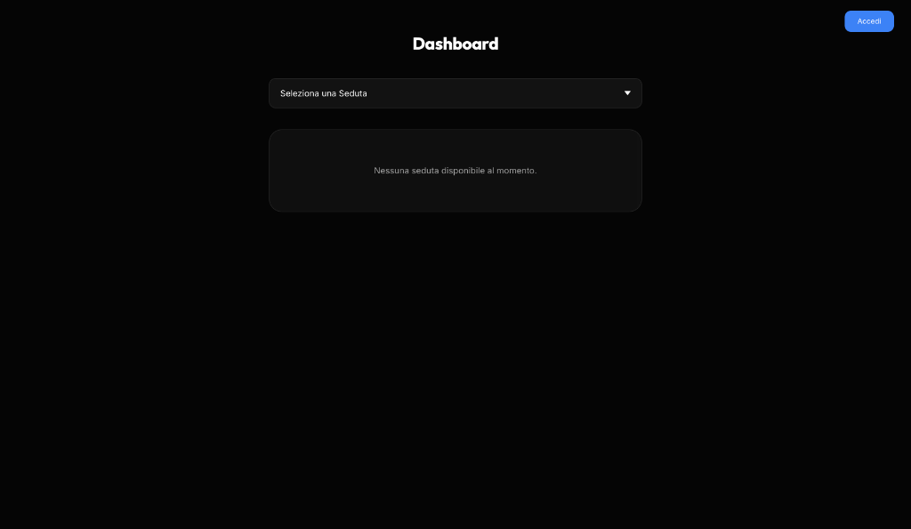
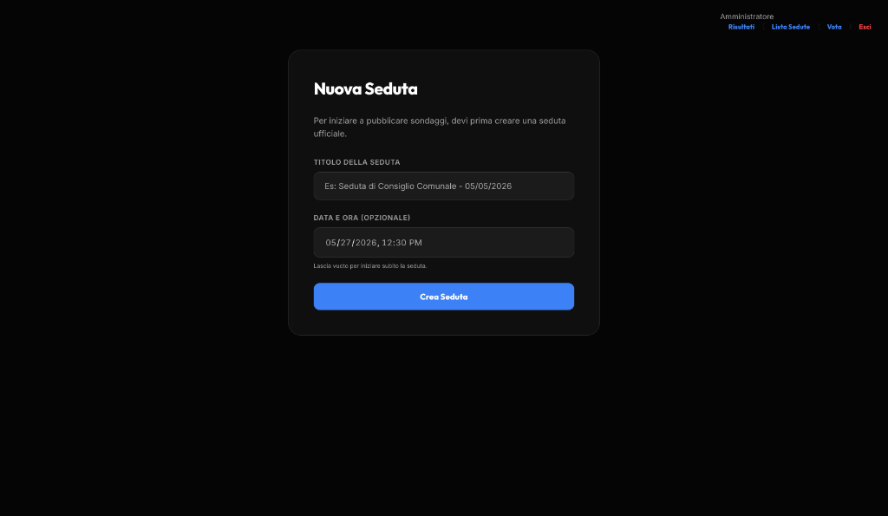
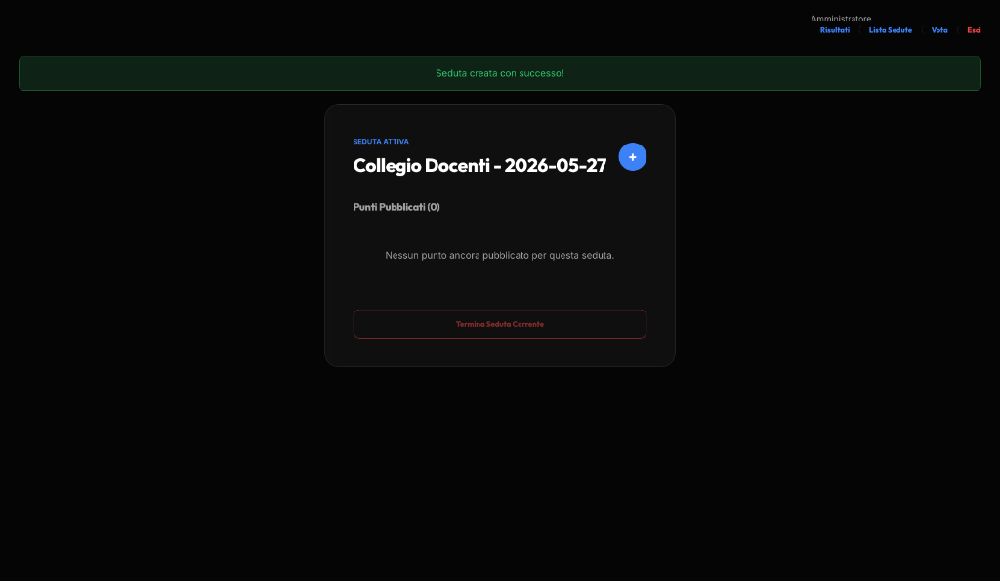
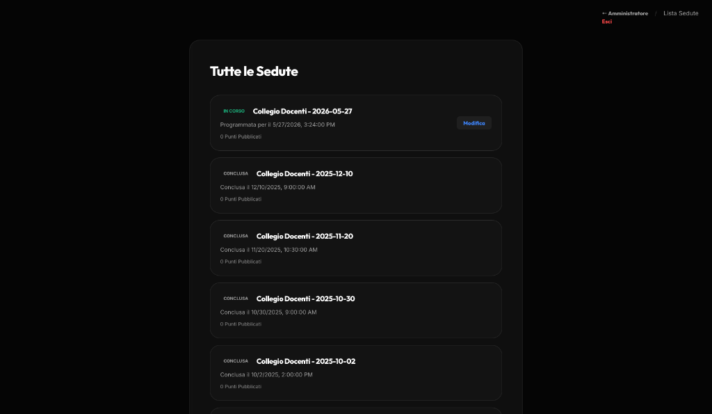
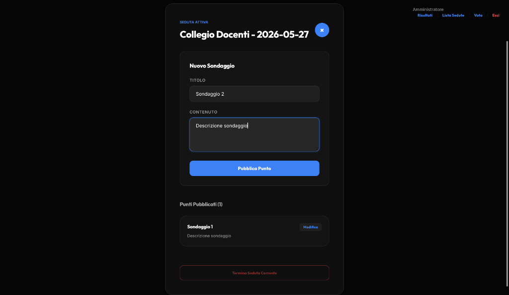
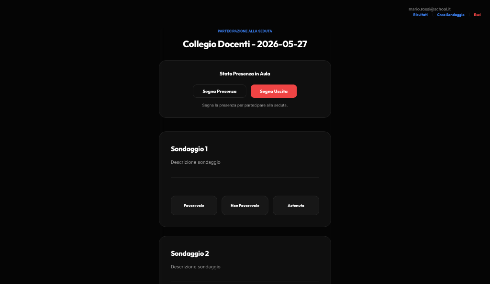
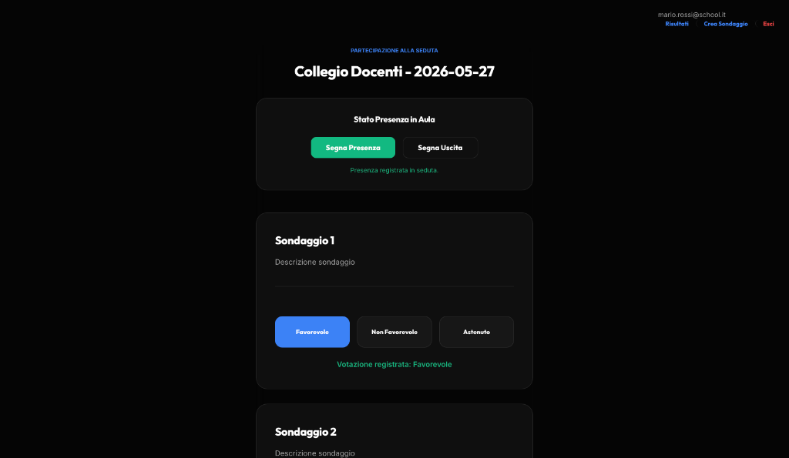
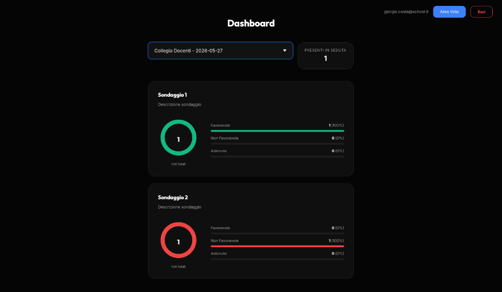

## Manuale utente

Di seguito viene descritto il flusso operativo dell'applicazione, corredato da screenshot dell'interfaccia.

---

### 1. Schermata di login

All'apertura del portale viene mostrata la schermata di benvenuto. L'utente deve inserire il **token di accesso** ricevuto dal dirigente e premere **Accedi**.

<p align="center">
  
</p>

> Il token è monouso: una volta effettuato il login, non potrà essere riutilizzato dopo il logout.

---

### 2. Dashboard

Dopo il login, viene mostrata la **Dashboard** con il selettore delle sedute. Se non ci sono sedute attive, viene visualizzato il messaggio *"Nessuna seduta disponibile al momento"*. Il pulsante **Accedi** nell'angolo in alto a destra permette di accedere alle funzionalità riservate.

<p align="center">
  
</p>

---

### 3. Scelta della destinazione (solo amministratore)

Dopo l'autenticazione come **amministratore (principal)**, viene presentata una schermata che consente di scegliere tra:

- **Crea Sondaggio**: accede alla gestione delle sedute e delle proposte di voto.
- **Vota**: accede alla schermata di votazione come un normale partecipante.

<p align="center">
  
</p>

---

### 4. Creazione di una nuova seduta

Dalla sezione di gestione, il dirigente può creare una **nuova seduta** compilando:

- **Titolo della seduta** (es. *Seduta di Consiglio Comunale - 05/05/2026*)
- **Data e ora** (opzionale — se lasciato vuoto, la seduta viene avviata immediatamente)

Premere **Crea Seduta** per confermare.

<p align="center">
  
</p>

> La barra di navigazione in alto a destra mostra le sezioni disponibili per l'amministratore: **Risultati**, **Lista Sedute**, **Voto**, **Esci**.

---

### 5. Seduta attiva

Una volta creata la seduta, viene mostrata la schermata della **seduta attiva** con:

- Il **titolo e la data** della seduta corrente
- Il badge **SEDUTA ATTIVA** in verde
- Il pulsante **+** per aggiungere nuovi punti all'ordine del giorno (proposte di voto)
- La lista dei **Punti Pubblicati** (inizialmente vuota)
- Il pulsante **Termina Seduta Corrente** per chiudere la seduta

<p align="center">
  
</p>

> Un banner verde di conferma appare in alto quando la seduta è stata creata con successo.

---

### 6. Lista sedute (storico)

Dalla sezione **Lista Sedute** (accessibile dalla barra di navigazione) è possibile consultare l'elenco completo delle sedute:

- Le sedute **in corso** sono contrassegnate dal badge verde **IN CORSO** e mostrano il pulsante **Modifica**.
- Le sedute **concluse** riportano il badge grigio **CONCLUSA** con data e ora di chiusura.
- Per ogni seduta viene indicato il numero di **Punti Pubblicati**.

<p align="center">
  
</p>

---

### 7. Creazione di un sondaggio (proposta di voto)

Dalla seduta attiva, premendo il pulsante **+** si apre il form **Nuovo Sondaggio** per aggiungere un punto all'ordine del giorno:

- **Titolo**: il nome della proposta (es. *Sondaggio 2*)
- **Contenuto**: la descrizione dettagliata della proposta

Premere **Pubblica Punto** per rendere il sondaggio disponibile ai partecipanti. I punti già pubblicati appaiono nella lista sottostante con il pulsante **Modifica**.

<p align="center">
  
</p>

> Il pulsante **×** (blu) in alto a destra chiude il form senza salvare.

---

### 8. Area voto — Registrazione presenza

Accedendo all'**Area Voto**, il partecipante visualizza la seduta corrente con:

- **Stato Presenza in Aula**: pulsanti **Segna Presenza** e **Segna Uscita** per registrare la propria presenza.
- La lista dei **sondaggi attivi** con i pulsanti di voto: **Favorevole**, **Non Favorevole**, **Astenuto**.

Prima di votare è necessario registrare la propria presenza premendo **Segna Presenza**.

<p align="center">
  
</p>

---

### 9. Voto espresso

Dopo aver registrato la presenza (il pulsante **Segna Presenza** diventa verde con conferma *"Presenza registrata in seduta"*), l'utente può esprimere il proprio voto su ogni sondaggio.

Una volta votato, il pulsante selezionato si evidenzia (es. **Favorevole** in blu) e appare il messaggio di conferma *"Votazione registrata: Favorevole"*.

<p align="center">
  
</p>

> Il voto può essere modificato in qualsiasi momento durante la seduta attiva selezionando una diversa opzione.

---

### 10. Dashboard risultati

La **Dashboard** mostra i risultati aggregati di ogni sondaggio per la seduta selezionata:

- Il **selettore** in alto permette di scegliere la seduta da visualizzare.
- Il contatore **PRESENTI IN SEDUTA** indica il numero di partecipanti registrati.
- Per ogni sondaggio viene mostrato un **grafico ad anello** con il conteggio totale dei voti e le **barre percentuali** per categoria:
  - 🟢 **Favorevole** — con conteggio e percentuale
  - 🔴 **Non Favorevole** — con conteggio e percentuale
  - ⚪ **Astenuto** — con conteggio e percentuale

<p align="center">
  
</p>

> Il colore dell'anello (verde o rosso) indica visivamente l'esito prevalente della votazione.

### Riepilogo del flusso per ruolo

#### Insegnante (teacher)

1. **Ricezione del token**: prima della seduta, il dirigente invia per email istituzionale un token univoco (es. `TOK-A1B2C3`).
2. **Accesso al portale**: nella schermata di login, inserire il token e premere **Accedi**.
3. **Registrazione automatica**: il sistema valida il token e registra automaticamente la presenza alla seduta corrente.
4. **Dashboard**: vengono mostrate le proposte di voto attive e lo storico delle sedute passate.
5. **Votazione**: per ogni proposta selezionare la propria posizione (**Favorevole** / **Contrario** / **Astenuto**) e premere **Vota**. Il voto può essere modificato fino alla chiusura della seduta.
6. **Storico**: dalla sezione storico è possibile consultare in sola lettura tutte le sedute passate, le proposte discusse e il loro esito.
7. **Logout**: al termine della seduta, cliccare **Esci**. Il token viene immediatamente invalidato.

#### Dirigente (principal)

Il dirigente dispone di tutti i privilegi dell'insegnante più le funzionalità di gestione.

**Provisioning pre-seduta:**

1. Creare la seduta tramite l'interfaccia web (sezione *Crea Sondaggio*) oppure via API `POST /meeting`.
2. Generare i token monouso per ogni partecipante e inserirli nella tabella `token` con la corretta associazione `user_email` / `meeting_id` e una scadenza corrispondente alla fine della seduta.
3. Inviare i token a ogni insegnante tramite email istituzionale.

Esempio di inserimento manuale di un token:
```sql
INSERT INTO token (code, generated_at, expires_at, user_email, meeting_id)
VALUES ('TOK-XYZ123', NOW(), '2025-10-15 11:00:00', 'luca.ferrari@school.it', 11);
```

Vincolo: ogni utente può avere al massimo un token per seduta (`UNIQUE (user_email, meeting_id)`).

**Gestione sedute:**

- **Creare una nuova seduta**: dalla schermata *Nuova Seduta*, inserire titolo e data/ora.
- **Modificare una seduta esistente** (`PUT /meeting?meeting_id=<id>`).
- **Consultare le statistiche** di una seduta (`GET /meeting/{id}/stats`): numero di partecipanti, orari, presidente.

**Gestione proposte:**

- **Creare una proposta**: dalla seduta attiva, premere il pulsante **+** per aggiungere un nuovo punto.
- **Modificare una proposta** (`PUT /proposal?proposal_id=<id>`).
- **Consultare i voti** di una proposta (`GET /proposal/{id}/votes`).

**Calcolo dell'esito:**

L'esito di ogni proposta viene calcolato a livello applicativo:

```
voti_favorevoli > (totale_partecipanti / 2)  →  APPROVATA
altrimenti                                   →  RESPINTA
```
